<picture><source media="(prefers-color-scheme: dark)" srcset="assets/hero-dark.svg"></picture>

I study computer science at FAST-NUCES in Islamabad. Most of what I build is for someone specific: indoor positioning for our final-year project, research on keeping digital twins in sync, and websites and apps for businesses around the city. I care about the unglamorous parts, like the edge cases, the data model and the bit the client will have to edit on their own.

**Right now**

- Building TURN's positioning: step detection, heading and a particle filter that knows the floor plan.
- Designing experiments on MQTT QoS and edge buffering for digital-twin sync.
- Shipping NeuroZehn, a bilingual site for a brain-health institute.
- Building a customer feedback platform for local businesses and planning a school information system. Both are private for now.

### Selected work

<a href="https://github.com/SMR202/turn-indoor-navigation"><picture><source media="(prefers-color-scheme: dark)" srcset="assets/work-turn-dark.svg">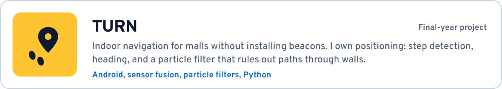</picture></a>
<a href="https://github.com/ZakiNabeel/AI-System-for-Live-and-Recorded-Online-Video-Understanding-and-Summarization"><picture><source media="(prefers-color-scheme: dark)" srcset="assets/work-lumen-dark.svg"></picture></a>
<a href="https://github.com/SMR202/Neurosphere-Global"><picture><source media="(prefers-color-scheme: dark)" srcset="assets/work-neurozehn-dark.svg">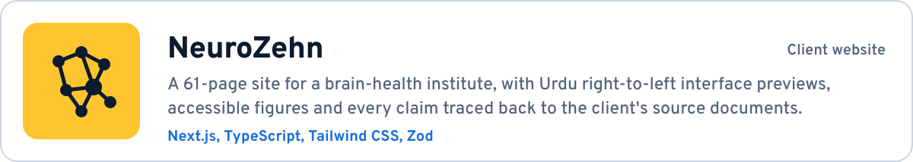</picture></a>
<a href="https://www.sameeramjad.xyz"><picture><source media="(prefers-color-scheme: dark)" srcset="assets/work-clients-dark.svg"></picture></a>
<a href="https://github.com/SMR202/AirControlX"><picture><source media="(prefers-color-scheme: dark)" srcset="assets/work-aircontrolx-dark.svg">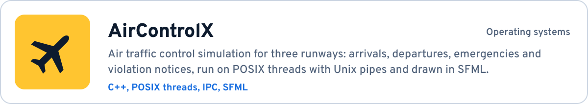</picture></a>
<a href="https://github.com/SMR202/dt-mqtt-resilience"><picture><source media="(prefers-color-scheme: dark)" srcset="assets/work-twin-dark.svg">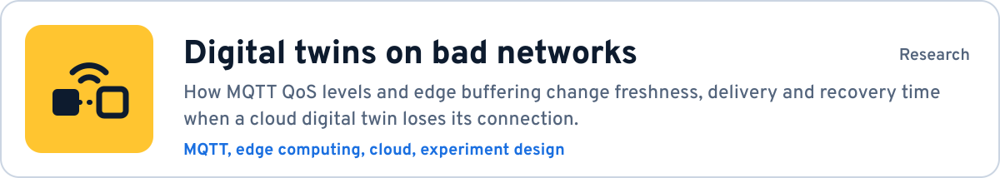</picture></a>
<a href="https://github.com/SMR202/IntegrityVerificationSystem"><picture><source media="(prefers-color-scheme: dark)" srcset="assets/work-merkle-dark.svg">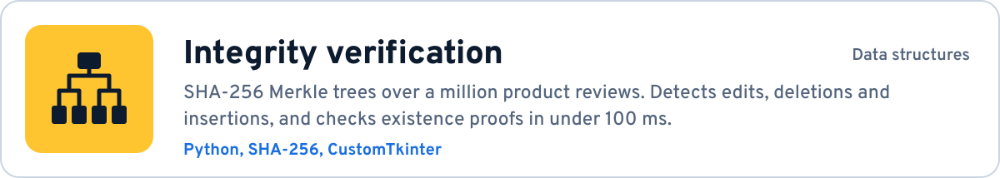</picture></a>
<a href="https://github.com/SMR202/LL-1-Parser"><picture><source media="(prefers-color-scheme: dark)" srcset="assets/work-parser-dark.svg"></picture></a>

<b>Fifteen more projects, from mobile apps to games</b>

 

**Apps and platforms**

- **Busin.** React Native bus tracking with live GPS over WebSockets and an ETA for every stop. *Private repo.*
- **Skill-Link.** Kotlin marketplace for local services, with bids, chat with media and push notifications. *Private repo.*
- [**SkillLink, rebuilt**](https://github.com/SMR202/SkillLink-Java-Expo). The same marketplace on Spring Boot with JWT roles and an Expo client. Team project.
- [**SkillLink API**](https://github.com/SMR202/SkillLinkWebAPI). Express, Sequelize and MySQL behind the Kotlin app, with Cloudinary uploads and Firebase messaging.
- [**Centaurus Experience**](https://github.com/SMR202/centaurus-experience). Expo prototype of a visitor app for The Centaurus Mall: directory, indoor directions, rewards and finding your car.
- [**Lakkar Home**](https://github.com/SMR202/Lakkar-Website). Furniture storefront with cash-on-delivery checkout, run entirely from the owner's Google Sheet.

**AI and automation**

- [**RACE reading comprehension**](https://github.com/SMR202/RACE-Reading-Comprehension-AI). Classical ML that checks answers and generates distractors and hints for reading quizzes.
- [**AI Resume Tailor**](https://github.com/SMR202/AiResumeTailor). Rewrites a resume for a specific job description through an n8n workflow and hands back a PDF.
- **Reddit to YouTube pipeline.** An n8n workflow that picks stories, rewrites them with Gemini, voices them with Azure TTS, renders with Remotion and uploads on a schedule.

**Systems**

- [**Git-Lite**](https://github.com/FatimaSohailll/Git-Lite). Version control on AVL, red-black and B-trees with Merkle-tree change tracking. Team project.
- [**Terminal NotePad**](https://github.com/SMR202/Terminal-NotePad). A command-line text editor in C++ with word suggestions and search.

**Desktop**

- [**SafeNest**](https://github.com/SMR202/SafeNest). JavaFX home-security dashboard for cameras, sensors and PIN-protected alarm modes.
- [**TravelEase**](https://github.com/SMR202/TravelEase). Travel booking in C# Windows Forms on SQL Server, with reports and triggers.

**Games**

- [**Plants vs. Zombies, in C++**](https://github.com/SMR202/PlantsVsZombies). Tower defence with factories for six plants and five zombies, built on SFML.
- [**Centipede, in C++**](https://github.com/SMR202/ATARI-Centipede). The arcade game rebuilt in SFML, one of my first C++ projects.

### Tools I use

<picture><source media="(prefers-color-scheme: dark)" srcset="assets/tools-dark.svg">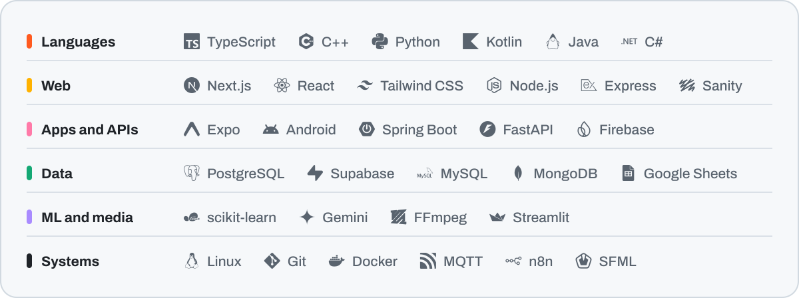</picture>

### Activity

<picture><source media="(prefers-color-scheme: dark)" srcset="assets/activity-dark.svg">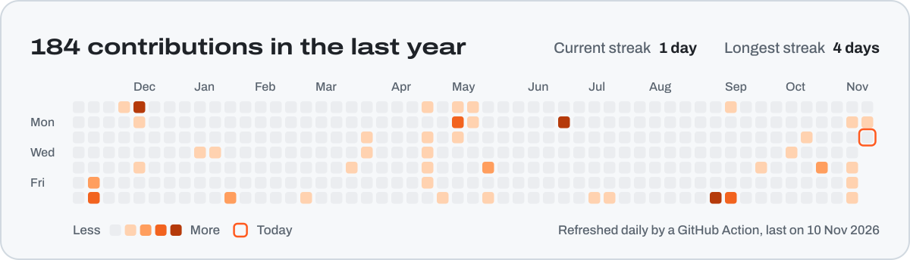</picture>

### Get in touch

<a href="mailto:sameeramjad202@gmail.com"><picture><source media="(prefers-color-scheme: dark)" srcset="assets/contact-email-dark.svg"></picture></a>
<a href="https://www.linkedin.com/in/sameeramjd"><picture><source media="(prefers-color-scheme: dark)" srcset="assets/contact-linkedin-dark.svg"></picture></a>
<a href="https://www.sameeramjad.xyz"><picture><source media="(prefers-color-scheme: dark)" srcset="assets/contact-portfolio-dark.svg"></picture></a>
<a href="https://www.sameeramjad.xyz/media/resume.pdf"><picture><source media="(prefers-color-scheme: dark)" srcset="assets/contact-resume-dark.svg"></picture></a>

The artwork here is drawn by code in <a href="scripts">scripts/</a>: each line follows a noise field and stops just before it touches another line or a letter. The activity panel is redrawn every night by a GitHub Action.
